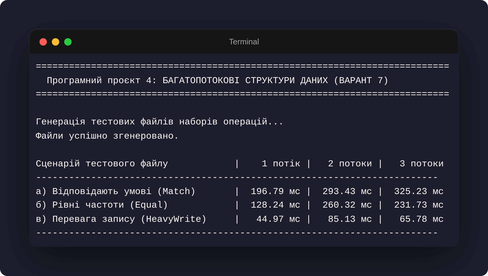

# Програмний проєкт 4. Засоби синхронізації та багатопотокового програмування мови С++. Багатопотокові структури даних з дрібнозернистим блокуванням.

## Задача 7: Оптимізація структури даних з 3 полів під заданий профіль навантаження (Варіант 7)

* **Виконав:** Величко Максим, група К-24
* **Цільовий стандарт:** C++23
* **Компілятор:** GCC 13.2+ / Clang 17.0+
* **Система збирання:** CMake 3.25+

---

## 1. Постановка задачі

Розробити структуру даних для багатопотокової програми з $m=3$ цілих полів (Поле 0, Поле 1, Поле 2), які можна читати та змінювати окремо. Для кожного поля реалізовано операції читання `read(idx)` та запису `write(idx, val)`, а також перевантажений `operator std::string()` для отримання знімка структури.

Усі атомарні змінні (`std::atomic`) та контейнери STL (`std::vector`, `std::map`) усередині структури строго заборонено. Для захисту використано звичайний масив `int data_[3]` та механізми взаємного виключення.

**Профіль частот операцій для Варіанта 7:**

* **Поле 0:** `read` = 5%, `write` = 5%
* **Поле 1:** `read` = 30%, `write` = 5%
* **Поле 2:** `read` = 24%, `write` = 1%
* **`operator std::string()`:** 30%

---

## 2. Схема захисту даних та її обґрунтування

1. **Дрібнозернисті м'ютекси читання-запису (`std::shared_mutex`):**

   * Для структури створено масив із 3 м'ютексів `std::shared_mutex mutexes_[3]`, по одному на кожне поле.
   * Сумарно операції читання складають **89%** від загальної кількості дій (`read 0` 5% + `read 1` 30% + `read 2` 24% + `string` $30\% \times 3$ полів).
   * Використання `std::shared_lock` під час читання дозволяє довільній кількості потоків одночасно читати як одне й те саме поле, так і різні поля без взаємних блокувань.
   * Операція `write` використовує `std::unique_lock` і блокує **тільки одне конкретне поле**. Оскільки частота запису дуже мала (всього 1%–5% на поле), ексклюзивні блокування відбуваються рідко і не зупиняють паралельну роботу з іншими полями.
2. **Ієрархічне блокування для `operator std::string()`:**

   * Для формування узгодженого знімка всі 3 м'ютекси блокуються у режимі `shared_lock`.
   * Щоб запобігти взаємним блокуванням (deadlocks), блокування завжди виконується в єдиному суворо визначеному порядку (Поле 0 $\to$ Поле 1 $\to$ Поле 2) за допомогою `std::lock()`.

---

## 3. Таблиця результатів вимірювання часу (300 000 операцій)

---

## 4. Висновки

**1) Вплив складності операції string на загальний час:**

* Сценарій **а) Match** показує найбільший абсолютний час виконання (196.79 -> 325.23 мс). Це пояснюється високою часткою операції `operator std::string()` (30%), яка вимагає форматування рядка (`std::format`) та виділення динамічної пам'яті під `std::string`.
* У сценарії **в) HeavyWrite** частота `string` становить лише 2%, завдяки чому примітивні операції читання/запису виконуються значно швидше (44.97 -> 65.78 мс).

**2) Аналіз паралельної ефективності на дрібних операціях:**

* Оскільки атомарні операції читання й зміни 3 примітивних `int` змінних у пам'яті є елементарними, накладні витрати на синхронізацію кількох м'ютексів (`std::shared_mutex`), арбітраж виклику `std::lock` та перемикання контексту потоків виявляються більшими за сам час виконання операцій.
* Це є класичним виявленням ефекту *lock contention* на простих структуризованих даних при відсутності тривалих обчислень у межах критичної секції.

---

## 5. Обсяг самостійно виконаної роботи

1) Самостійно розроблено клас багатопотокової структури даних `ConcurrentDataStore` з підтримкою роздільних дрібнозернистих м'ютексів `std::shared_mutex`.
2) Реалізовано алгоритм безпечного одночасного блокування `std::lock` для створення знімка структури в `operator std::string()`.
3) Створено генератор вибірок операцій із заданим розподілом ймовірностей для створення трьох типів тестових файлів.
4) Написано багатопотоковий бенчмарк з поділом масиву дій між потоками та вимірюванням часу високоточним таймером `std::chrono::high_resolution_clock`.
